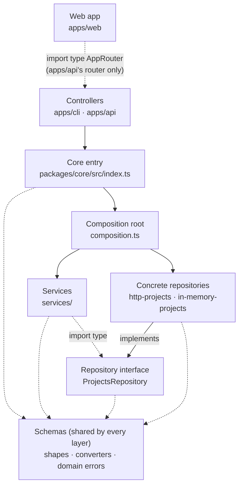
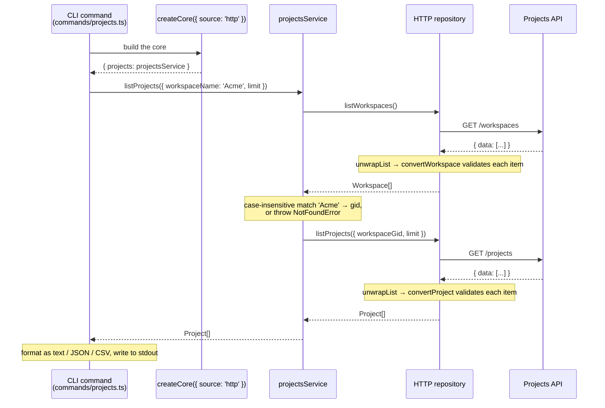

# Architecture

This page explains why the code is shaped the way it is and how to work in
it. Read it before adding a feature. The rules it describes are enforced
automatically; see [Architecture Boundary Rules](../reference/boundary-rules.md).

## Overview

The repo is a pnpm workspace with four parts:

- **The core library** (`packages/core`, `@ts-launch-blueprint/core`): the
  data shapes, data access and business rules. It knows nothing about who
  calls it.
- **The CLI** (`apps/cli`, the `ts-projects` command and the published npm
  package): one controller that calls the core.
- **The API** (`apps/api`, Hono + tRPC): a second controller over the same
  core. See the [API Reference](../reference/api-reference.md).
- **The web app** (`apps/web`, React + Vite): a browser client of the API.
  It imports only the API's router **type**, so it gets end-to-end types
  with none of the server's code. See the [Web App](../reference/web-app.md).

The goal is a ready web template: the CLI and the API run the same business
logic, and each part can be removed on its own. Delete an app and the rest
still works; `just check-removable cli` proves it on every CI run.

## The Layers

| Layer            | Folder                                                                       | Responsibility                                                                                                      | May import                                                     | Must not import                                        |
| ---------------- | ---------------------------------------------------------------------------- | ------------------------------------------------------------------------------------------------------------------- | -------------------------------------------------------------- | ------------------------------------------------------ |
| Schemas          | [`packages/core/src/schemas/`](../../packages/core/src/schemas/)             | Data shapes (Zod schemas and the `Project`/`Workspace` types), converters that validate one raw item, domain errors | Other `schemas/` files, `zod`                                  | Every other layer, any framework                       |
| Repositories     | [`packages/core/src/repositories/`](../../packages/core/src/repositories/)   | Data access behind the `ProjectsRepository` interface, with an HTTP and an in-memory implementation                 | `schemas/`                                                     | `services/`, `composition.ts`, any framework           |
| Services         | [`packages/core/src/services/`](../../packages/core/src/services/)           | Business rules: the case-insensitive workspace lookup, the default limit (200), `NotFoundError`                     | `schemas/`, and the repository interface as `import type` only | Concrete repositories, `composition.ts`, any framework |
| Composition root | [`packages/core/src/composition.ts`](../../packages/core/src/composition.ts) | `createCore`: the only place that picks a repository implementation and builds the services on it                   | Repositories, services                                         | Apps, any framework                                    |
| Controllers      | [`apps/cli/`](../../apps/cli/), [`apps/api/`](../../apps/api/)               | Turn input (flags, a request) into a service call, and the result or error into output                              | The core, only as `@ts-launch-blueprint/core`                  | `packages/core/src/...` paths, other apps              |

Apps reach the core only through its entry,
[`packages/core/src/index.ts`](../../packages/core/src/index.ts). Nothing in
the core imports an app.

## Two Diagrams

The first diagram shows **what may import what**. The second shows **what
happens at runtime**. They are different questions: the schemas layer appears
in the first as a shared box, because **schemas are used by every layer and
are not a step in the request flow**. A request never "goes through" the
schemas; the layers that handle it use the shapes and converters defined
there.

### Import direction (what may import what)

### Request flow (what happens at runtime)

`ts-projects projects --workspace Acme`:

- **The CLI uses the HTTP source by default**
  ([`apps/cli/src/cli/commands/projects.ts`](../../apps/cli/src/cli/commands/projects.ts)
  calls `createCore({ source: 'http', … })`). The API URL defaults to a
  placeholder; the `TS_PROJECTS_API_URL` environment variable points it at a
  real server. `--source memory` / `TS_PROJECTS_SOURCE=memory` runs the CLI on
  the in-memory seed instead (`createCore({ source: 'memory' })`), with no
  token and no server.
- **Only data from outside is validated.** The HTTP repository runs every
  item through the converter (`unwrapList` → `convertProject` /
  `convertWorkspace`). The in-memory repository returns its seed as is,
  without validation, because the seed is trusted data defined in code.
- **The API takes the same path** from a tRPC procedure instead of a CLI
  command (`GET /trpc/projects.list` → `createCore` →
  `projectsService.listProjects` → the repository); see the
  [API Reference](../reference/api-reference.md). Unlike the CLI, the API
  uses the in-memory seed by default (D-048).

## Errors

The core throws **domain errors** that describe what went wrong and carry no
transport detail (no exit code, no HTTP status):
[`packages/core/src/schemas/errors.ts`](../../packages/core/src/schemas/errors.ts).
Each controller decides how to report them: the CLI with `exitCodeFor` in
[`apps/cli/src/cli/exit-codes.ts`](../../apps/cli/src/cli/exit-codes.ts), the
API with `toTRPCError` in
[`apps/api/src/errors.ts`](../../apps/api/src/errors.ts) (D-049):

| Error                  | Raised by                                    | CLI exit code | API (HTTP) |
| ---------------------- | -------------------------------------------- | ------------- | ---------- |
| `NotFoundError`        | core (unknown workspace)                     | 3             | 404        |
| `AuthError`            | core (token rejected); CLI (no token found)  | 4             | 502        |
| `ConflictError`        | core (defined; nothing throws it yet)        | 5             | 409        |
| `ApiError`             | core (network, timeout, bad response)        | 1             | 502        |
| `UsageError`           | CLI only (bad flag, missing `--config` file) | 2             | —          |
| `ConfigError`          | CLI only (bad config file)                   | 1             | —          |
| `CliError` with a code | CLI only                                     | that code     | —          |
| invalid API input      | API only (contract validation)               | —             | 400        |
| anything else          | —                                            | 1             | 500        |

`AuthError` differs on purpose: in the CLI the user supplies the token, so
it's theirs to fix (exit 4); in the API the token is server configuration,
so the API's caller sees an upstream failure (502), not "log in" (401). The
API's 5xx responses carry a generic message, and the original error goes to
the server log.

Observability is a controller concern too: the API writes structured JSON
logs, serves metrics and records traces (D-051 to D-053,
[Observability](../reference/observability.md)), and the core stays free of
all three, so it reports failures only by throwing. The
`[core-no-framework-import]` rule enforces it: the core can't import `pino`,
`prom-client` or `@opentelemetry/*`.

## Swapping the Data Source

`createCore` takes the data source as configuration:

- `createCore({ source: 'http', http: { token, fetchImpl, baseUrl } })` uses
  the HTTP repository.
- `createCore({ source: 'memory', seed })` uses the in-memory repository, with
  the built-in demo seed if no `seed` is given.

Services and controllers don't change when the source changes. A future
source (for example Firestore):

1. implements `ProjectsRepository`
   ([`packages/core/src/repositories/projects.repository.ts`](../../packages/core/src/repositories/projects.repository.ts));
2. gets a new `source` option in `composition.ts`;
3. must pass the shared contract test,
   [`packages/core/tests/projects-repository.contract.test.ts`](../../packages/core/tests/projects-repository.contract.test.ts),
   which runs the same cases against every implementation.

## How to Add a Feature

A made-up example, "get one project by id", touches each layer in this order:

1. **Schema and converter.** Reuse `ProjectSchema` if the shape is the same;
   otherwise add the schema and a converter in `packages/core/src/schemas/`,
   with tests in `packages/core/tests/project.schema.test.ts`.
2. **Repository.** Add `getProject(id)` to the `ProjectsRepository`
   interface, implement it in both the HTTP and the in-memory repository, and
   add cases to the shared contract test.
3. **Service.** Add the business rule (for example, `NotFoundError` when the
   id is unknown) to the projects service, tested with the in-memory
   repository (no fetch mocks), as in
   `packages/core/tests/projects.service.test.ts`.
4. **Core entry.** Export it from `packages/core/src/index.ts` only if an app
   needs it, and add it to `packages/core/tests/public-api.test.ts`. If the
   operation is exposed by the API, add its contract schemas next to the shape
   in `schemas/` (like `projects.contract.ts`) and export them.
5. **Controller.** A CLI command (in `apps/cli/src/cli/commands/`) and/or a
   tRPC procedure (in `apps/api/src/router.ts`), calling the service through
   `createCore`.
6. **Check.** Run `just all`: it includes the lint and boundary rules, so a
   wrong import fails here, with a tag that
   [Architecture Boundary Rules](../reference/boundary-rules.md) explains.

## Mapping to BankSheets and PyLaunch

The layers follow BankSheets (decision D-039), with two ideas taken from
PyLaunch's hexagonal design: a repository interface, and a single place that
wires implementations.

| This repo                                   | BankSheets pattern            | PyLaunch pattern          |
| ------------------------------------------- | ----------------------------- | ------------------------- |
| Schemas (shapes, converters, domain errors) | Schemas and converters        | Models, errors            |
| Repository interface (`ProjectsRepository`) | — (repositories are concrete) | Ports                     |
| HTTP / in-memory repositories               | Repositories                  | Adapters (API, in-memory) |
| Services                                    | Services                      | Services                  |
| Composition root (`createCore`)             | —                             | Composition root (wiring) |
| Controllers (`apps/cli`, `apps/api`)        | Controllers / routes          | CLI and web front-ends    |

Deliberate differences:

- **A real pnpm workspace package** for the core, imported by its package
  name, instead of tsconfig path aliases (D-040). The `[no-path-alias]` rule
  keeps it that way.
- **Node-first** for the CLI and the API, with Bun as an optional lane (D-044).

## What's Next

Built: **`apps/api`**, Hono + tRPC (D-043, D-048). Its `projects.list`
procedure calls the same projects service as the CLI. **`apps/web`**, React +
Vite (D-054), calls it through a typed tRPC client; it imports only the
API's router **type** (`AppRouter`), never runtime code, and
`[web-types-only-from-api]` enforces that.

Next: the real projects screen in the web app, with styling and routing.

The core exports the `listProjects` contract schemas
(`ListProjectsInputSchema`, `ListProjectsOutputSchema`, in
[`packages/core/src/schemas/projects.contract.ts`](../../packages/core/src/schemas/projects.contract.ts))
for controllers to validate with; converters and the raw-API schemas stay
internal (D-047). The core public-API test
(`packages/core/tests/public-api.test.ts`) locks exactly what is exported.

## See Also

- [Architecture Boundary Rules](../reference/boundary-rules.md): every rule,
  how to read a failure, and how to remove an app.
- [Project Structure](../reference/project-structure.md): the full directory
  layout.
- Decisions D-039 to D-045 in
  [`docs/port/TS_PORT_DECISIONS.md`](../port/TS_PORT_DECISIONS.md): the
  layers, the workspace, the boundary tools, the API stack, the runtime and
  the publishing pause.
